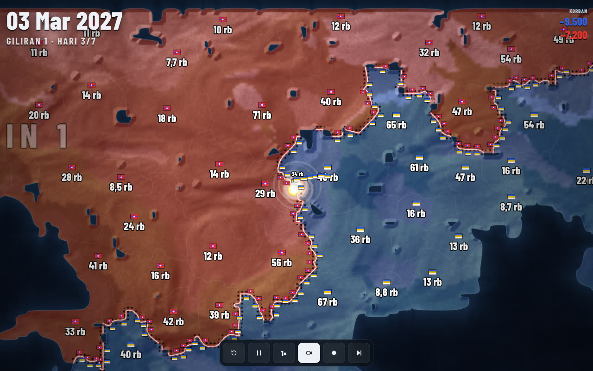
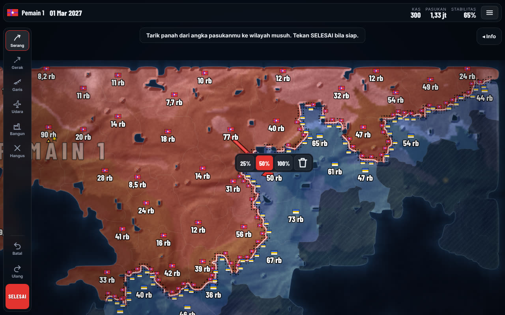
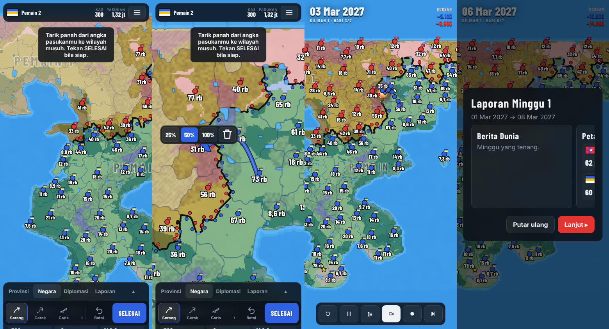

# GARIS DEPAN

Game strategi peta: kamu memimpin negara dengan **menggambar langsung di peta**, yaitu panah serangan, garis pertahanan, jalan/rel, dan bangunan. Gilirannya simultan (WEGO), bisa **hot-seat 2–8 orang di satu HP/PC**, dan tiap giliran diputar seperti video peta perang yang viral.



| Perencanaan (Satelit) | Tema Kartun di HP |
| --- | --- |
|  |  |

Dokumen desain lengkap: [`docs/RENCANA.md`](docs/RENCANA.md).

## Main online

Setelah di-merge ke `main`, game otomatis dipublikasikan ke GitHub Pages di `https://ardelyo.github.io/GarisDepan/`. Aktifkan sekali di **Settings → Pages → Source: GitHub Actions**. Bila Source dibiarkan "Deploy from a branch", pilih branch **gh-pages** dan folder **/ (root)**; workflow mengisinya otomatis. Jangan memakai branch `main`, karena itu menyajikan file sumber mentah dan halaman tampil putih.

## Menjalankan

```bash
npm install
npm run dev        # buka http://localhost:5173
npm test           # tes peta & simulasi (headless, AI vs AI)
npm run build      # build statis ke dist/ (bisa di-host di mana saja)
```

Butuh Node 20+. Hasil build berupa web statis biasa, sehingga bisa dibungkus Capacitor (Android/iOS) atau Tauri (PC) tanpa mengubah kode.

## Yang sudah bisa dimainkan

**Alur hot-seat WEGO**
- Lobi: bentuk peta (Semenanjung, Benua, Kepulauan, Dua Benua), ukuran (±55/100/170 provinsi), seed yang bisa dibagikan, tema, 2–8 negara manusia/AI, negara kecil netral, tempo (Santai / Komando 90 d / Blitz 45 d), kesulitan AI, kondisi menang.
- **Tirai privasi**: peta di-blur saat perangkat berpindah tangan, *tahan 1 detik* untuk membuka, PIN 4 digit opsional. Panah lawan tidak pernah dirender di layar bersama, dan **kabut perang** menyembunyikan kekuatan di luar jangkauan.
- Urutan perencanaan diacak tiap giliran. Simpan otomatis di awal giliran, lalu bisa *Lanjutkan* dari lobi.

**Gambar = perintah**
| Alat | Gambar | Efek |
| --- | --- | --- |
| Serang | panah dari pasukanmu ke target; panah melengkung = rute pilihan | tebal 25/50/100% (ketuk panah atau scroll saat menggambar) |
| Serang | **lingkari** wilayah lawan | operasi jepit: panah otomatis dari semua provinsi yang bersebelahan, bonus +20% dari ≥2 arah |
| Gerak | panah putus-putus | reposisi tanpa menyerang |
| Garis | gores sepanjang perbatasan | pasukan diratakan sepanjang garis, gali parit +25% |
| Udara | lingkari area | +20% serangan/pertahanan di area, bom lawan |
| Bangun | ketuk provinsi / gores garis | pabrik, pabrik militer, benteng, pelabuhan, perluasan kota, jalan/rel |
| Hangus | ketuk provinsi sendiri | bumi hangus: musuh melambat, infrastrukturmu rusak |

Goresan dihaluskan (Douglas–Peucker, lalu Catmull–Rom), dikenali sebagai garis atau lingkaran, dan di-*snap* ke provinsi. Perintah tidak valid tampil merah putus-putus beserta alasannya. Undo/redo tersedia lewat tombol, Ctrl+Z/Y, atau geser tiga jari.

**Simulasi dunia** (deterministik, terpisah dari render)
- 7 hari per giliran, dihitung per hari. Kolom pasukan bergerak ±1 provinsi/hari mengikuti medan & infrastruktur. Dua serangan yang bertemu menjadi *meeting engagement*.
- **Manuver**: kolom yang jauh lebih kuat (±4:1) *melindas* garnisun lemah tanpa berhenti; wilayah musuh yang kosong atau lemah di sebelah pasukan yang sedang maju ikut *terserap*, dan kantong yang terkepung runtuh. Garnisun awal tipis di pedalaman, penuh di ibu kota & kota.
- Pertempuran memakai hukum kuadrat Lanchester yang disederhanakan, dengan pengubah medan (gunung ×1,5), benteng, kota, ibu kota, parit, suplai, moral, dukungan udara, dan penalti amfibi. Terobosan pada rasio efektif 1,3:1; penyerang dapat inisiatif +20% di dua hari pertama dan pertahanan tanpa parit/benteng −8%, jadi dataran bisa direbut dengan kekuatan setara, sementara hutan, bukit, gunung, kota, dan garis pertahanan butuh konsentrasi atau jepitan.
- **Logistik**: suplai mengalir dari ibu kota/kota lewat wilayah sendiri; jalan/rel memperpanjang jangkauannya. Di ujung jalur suplai pasukan −4%/minggu dan tempur −18%; terputus total −10%/minggu dan tempur −35%. Pasukan yang terkepung tanpa jalur mundur dihancurkan (DIKEPUNG!).
- **Kapasitas provinsi**: tiap provinsi hanya sanggup menghidupi sejumlah pasukan (naik dengan jalan/rel dan kota); kelebihannya hilang 15%/giliran. Penguatan otomatis hanya masuk ke provinsi yang masih punya ruang.
- **Rasio kekuatan**: saat menggambar panah serang, label di ujung panah menunjukkan perkiraan rasio penyerang:pembela (hijau ≥2:1, kuning ≥1,3:1, merah di bawahnya, abu-abu jika tertutup kabut). Beberapa panah ke target yang sama dijumlahkan, termasuk bonus jepit.
- **Ekonomi**: PDB = populasi × pabrik × infrastruktur × integrasi × stabilitas. Separuh pajak dibelanjakan otomatis lewat slider Militer/Sipil/Riset, separuh lagi masuk kas untuk bangun/rekrut. Ada batas mobilisasi 2,5% populasi, riset menaikkan kualitas peralatan (maksimal 150%), dan wilayah pendudukan baru produktif setelah integrasi.
- **Politik**: stabilitas, kelelahan perang, demokrasi/otoriter, kudeta, event acak berbasis kondisi dengan pilihan (krisis pangan, demo, skandal, bencana, terobosan riset, relawan).
- **Diplomasi**: deklarasi perang, damai (garis depan saat itu menjadi perbatasan), aliansi pertahanan (sekutu ikut perang), pakta non-agresi, dagang, dan reputasi untuk pengkhianatan. Ada kotak masuk rahasia antarpemain manusia, mata-mata yang membuka intel lawan selama satu giliran, gencatan senjata 8 giliran, dan pemerintahan pengasingan.
- **AI**: utility AI per negara (kepribadian netral/oportunis/agresif/pasifis) yang menghasilkan perintah dalam format yang sama dengan pemain.
- Kondisi menang: Dominasi (porsi populasi dunia yang menyesuaikan jumlah kekuatan besar: 60% untuk 2, ±42% untuk 4, ±34% untuk 8; atau semua ibu kota lawan), Ekonomi (40% PDB selama 12 giliran), Skor saat batas giliran, atau kekuatan besar terakhir yang tersisa.

**Tontonan**
- Dua tema dengan satu sistem animasi: **Satelit** (gelap, perbatasan bercahaya, stipple di tepi depan, lampu kota) dan **Kartun** (flat cerah, garis depan hitam bergaya spidol, unit bulat).
- **Resolusi progresif** (meniru video referensi): ±4,5 detik per hari, peristiwa tersebar di dalam hari. Wilayah yang direbut tumbuh **sel demi sel** dari titik masuk: titik-titik tipis di depan, tepi terang, isi di belakangnya.
- **Panah pemain dipakai**: pasukan berbaris tepat di sepanjang garis yang digambar, dan panah "termakan" dari ekor seiring pasukan maju. Tiap pasukan tampil sebagai blok formasi dengan satu kartu unit (bendera, nama, kekuatan).
- **Pasukan cerdas**: saat berbaris, pasukan memeriksa sayapnya. Bila ada musuh di samping (atau pasukan musuh menuju posisinya), sebagian (maks 30%) memisahkan diri sebagai penjaga sayap, menggali parit, dan terlihat berlari ke perbatasan yang terancam. Formasi berubah dari blok kolom saat berbaris menjadi garis yang mengikuti seluruh perbatasan yang menghadap musuh saat mendekat/bertempur, lalu kembali menjadi kolom setelah tembus.
- Ledakan lima tahap ±5,5 detik (gelombang kejut, bola api, puncak kecokelatan, asap hitam, hanyut), kabut asap yang menetap, rudal berjejak terang, cincin reticle di sasaran, urutan pendaratan amfibi, pesawat patroli & konvoi kapal yang selalu bergerak.
- Kamera **terkunci** pada teater giliran itu dengan push-in pelan; **kamera sutradara** (sorot pertempuran terbesar dengan sapuan + motion blur) bisa dinyalakan. Jeda, 1×/2×/4×, putar ulang, lewati.
- **Rekam Resolusi** mengekspor giliran sebagai video vertikal 9:16 (WebM) dengan cap tanggal & korban.
- Audio sintetis WebAudio (artileri, coretan spidol, pesawat, drone ambien yang naik saat pertempuran). Tanpa file aset.

**Aksesibilitas & kontrol**: target sentuh ≥44 px, mode kidal, pola arsir buta warna per negara, tata letak portrait (dock bawah) dan landscape/PC (dock kiri, panel kanan).

| Aksi | HP | PC |
| --- | --- | --- |
| Geser / zoom | dua jari / cubit, atau alat **Geser** (1 jari) | klik kanan tahan, WASD / scroll, tombol `H` |
| Gambar | satu jari | klik kiri tahan |
| Bangun / info | tekan lama | klik |
| Alat | dock | `1`–`6` |
| Batal / ulang | geser 3 jari | Ctrl+Z / Ctrl+Y |
| Selesai | tombol SELESAI | Enter |

## Arsitektur

```
src/
  core/      RNG deterministik, simplex noise, geometri (DP, Chaikin, Catmull–Rom), nama provinsi
  map/       generator peta prosedural → provinsi + graf ketetanggaan + busur perbatasan bersama
  sim/       simulasi murni: setup, rules, resolusi WEGO, ekonomi, event, AI (tanpa akses DOM)
  render/    Canvas 2D: terrain pra-render, cache layer politik, efek, sutradara resolusi, perekam
  input/     gesture sentuh/mouse + pengenal goresan
  ui/        lobi, helper DOM, CSS
  game.ts    controller: alur hot-seat, tirai, alat gambar, lembar bawah, laporan
```

`resolveTurn(map, state, orders) → { state baru, frames per hari + log event }` dihitung dalam ±10 ms. Sutradara hanya "membacakan" log itu, sehingga replay, rekam video, mode cepat, dan nanti multiplayer asinkron (cukup kirim file perintah) jadi murah. Tes memverifikasi bahwa replay dengan seed yang sama menghasilkan state identik.

Semua angka balancing ada di `src/sim/rules.ts` (`RULES`, `BUILD_INFO`). Itu nilai awal, bukan data dunia nyata.

## Keputusan untuk rilis ini (dari "pertanyaan terbuka")

- **Tema**: keduanya, bisa diganti kapan saja dari menu.
- **Engine**: TypeScript + Canvas 2D (tanpa dependensi runtime). Renderer terisolasi di `src/render/`, jadi bisa dipindah ke PixiJS/WebGL bila peta ±600 provinsi butuh lebih banyak performa.
- **Ekonomi**: versi menengah. Pabrik, pabrik militer, benteng, pelabuhan, kota, dan jalan sudah ada, plus anggaran otomatis. Rantai produksi penuh (baja/minyak per unit) belum.

## Belum dibuat (roadmap)

- Peta dunia nyata dari Natural Earth admin-1, dan editor peta "Kanvas Kosong" (`.gdmap`).
- Dewan Dunia & kemenangan diplomasi, mode Tim, mode Wasit/cast, tutorial interaktif 5 misi.
- Armada laut sebagai unit terpisah dan blokade rute dagang. Saat ini invasi amfibi memakai jalur selat + pelabuhan.
- LAN / online asinkron, pembungkus Capacitor/Tauri, musik orkestra.
