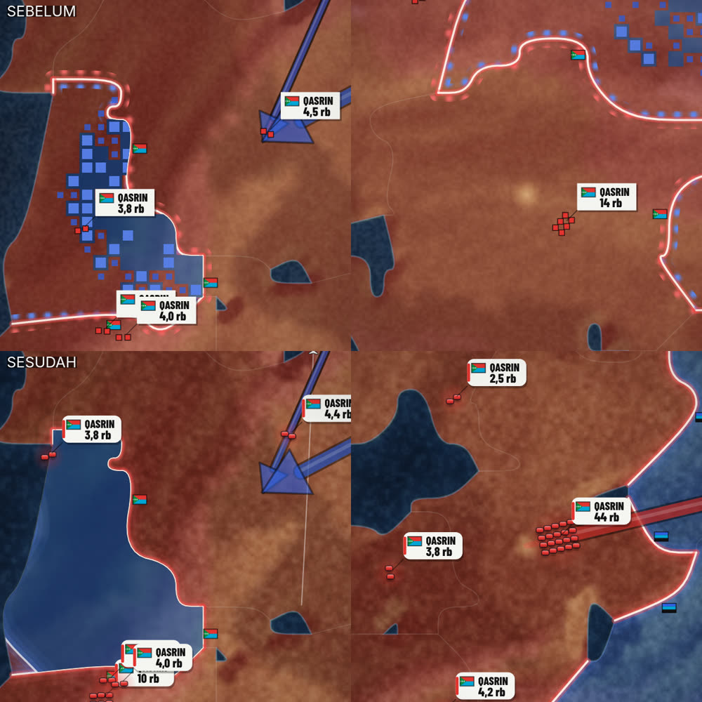

# Evaluasi animasi, desain, dan aset

Tujuan: animasi terasa **cair** seperti video referensi, bukan seperti game pixel. Setiap temuan di bawah diukur atau difoto sebelum diperbaiki.

## Temuan dan perbaikan

| # | Temuan (bukti) | Perbaikan |
| --- | --- | --- |
| 1 | **Wilayah yang direbut tumbuh sebagai kotak 5×5 px** yang berundak seperti tangga (foto zoom). | Pertumbuhan berupa gumpalan organik: tepinya bernapas dengan noise frekuensi rendah, dipotong ke batas provinsi, dengan rim bercahaya tiga lapis. Tidak ada kotak lagi. |
| 2 | **Gerak pasukan berhenti-jalan tiap 4,5 detik.** Pada kolom yang sama kecepatan melompat 0 → 17,8 dalam satu sampel di batas hari. | Penghalusan orde-1 (konstanta 520 ms) pada posisi dan jumlah pasukan. Kecepatan kini naik bertahap 0,3 → 4,4 → 7,8 → 10,3 → 12,2 → 13,6 selama ±1 detik. Interpolasi `easeInOut` per hari pada jumlah pasukan dihapus. |
| 3 | **Pasukan berupa kotak merah kecil tanpa kesan massa.** | Token bulat-lembut dengan gradien, tepi spekular, dan bayangan kontak (sprite 3× supersampling, murah digambar). Di bawah formasi ada jejak massa lembut. Goyangan berjalan kecil, kartu unit bersudut membulat. |
| 4 | **Titik-titik stipple membentuk grid** di garis depan dan wilayah pendudukan. | Garis depan memakai pita cahaya lembut di kedua sisi; wilayah pendudukan memakai arsir diagonal halus. |
| 5 | **Tekstur peta buram saat di-zoom** (1 px per unit dunia, dibesarkan 3×). Menaikkan ke 1,5× hanya memberi sedikit manfaat dengan biaya 1,4 detik. | Tetap 1× (isinya memang halus), laut dihitung 0,5×, dan ditambah lapisan detail soft-light beresolusi layar yang tetap tajam di zoom berapa pun. Pembangunan tekstur kini bertahap (tidak membekukan UI), memakai cache, dan peta lama tetap terlihat saat ganti tema. |
| 6 | **Emoji di UI** (🏭 🏰 ⚓ 🕵 🎲 …) tampil berbeda di tiap HP. | Set ikon vektor tunggal (24 ikon) untuk tombol, menu bangun, diplomasi, lobi, dan lencana di kanvas. |
| 7 | **Font dimuat dari Google Fonts.** Tanpa internet atau saat lambat, teks kanvas jatuh ke font cadangan. | Font dipaketkan ke build (Barlow Condensed, Inter), dimuat lebih dulu. |
| 8 | Tidak bisa dipasang atau dipakai offline. | Manifest PWA, ikon (192/512/maskable/iOS), service worker. Terbukti: setelah kunjungan pertama, muat ulang saat offline tetap membuka game. |
| 9 | Kamera di HP portrait memuat seluruh peta; area pertempuran kecil. | Bingkai kamera dihitung dari titik pertempuran dan titik masuk (dengan pemangkasan outlier), dan sedikit overscroll di tepi peta. |

## Gestur mobile (diuji dengan touch event CDP)

- Satu jari menggambar; dua jari geser + cubit; alat **Geser** untuk satu jari.
- **Inersia**: geseran cepat terus meluncur setelah jari diangkat (81 → 175 unit setelah lepas).
- **Ketuk dua kali** zoom ke titik itu (×2,2); sekali lagi kembali ke seluruh peta. Kamera memakai animasi ease in-out, dibatalkan begitu jari menyentuh lagi.
- **Getar haptik** saat perintah dibuat, kesalahan, SELESAI, perebutan, dan ibu kota jatuh (bisa dimatikan di menu).
- **Kualitas adaptif**: bila rata-rata frame lebih dari 28 ms, resolusi kanvas dan jumlah partikel diturunkan bertahap; logika game tidak berubah.

## Cara mengukur ulang

- Kelancaran gerak: rekam `game.lastFrame.cols` tiap `requestAnimationFrame` selama satu resolusi, hitung kecepatan `du/dt` di sekitar batas hari. Setel `game.dir.smoothTau = 1` untuk membandingkan tanpa penghalusan.
- Waktu bangun terrain: `buildBase(map, theme)` kini async; ukur dengan `performance.now()`.
- Sentuhan: Playwright dengan `hasTouch` dan `Input.dispatchTouchEvent` (bukan event mouse).
